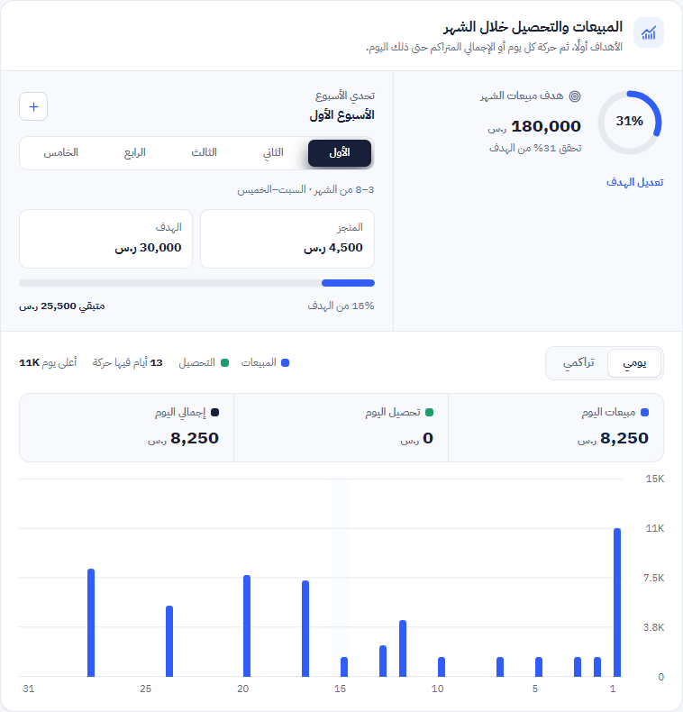
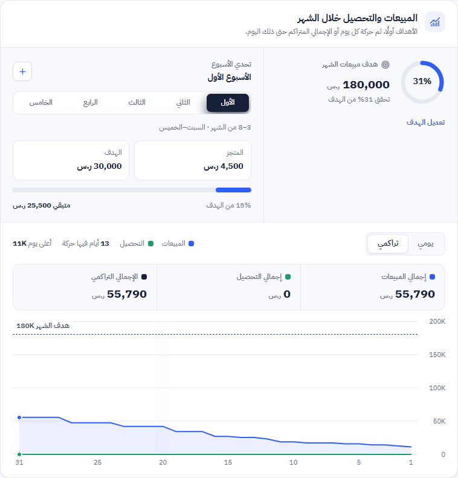
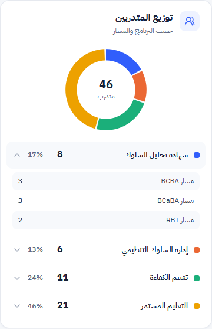
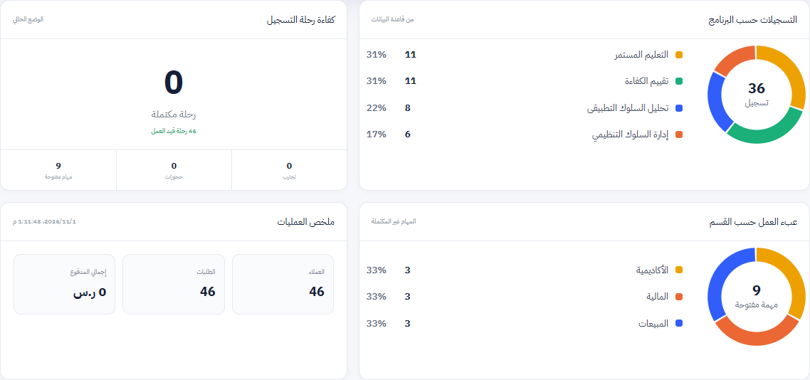
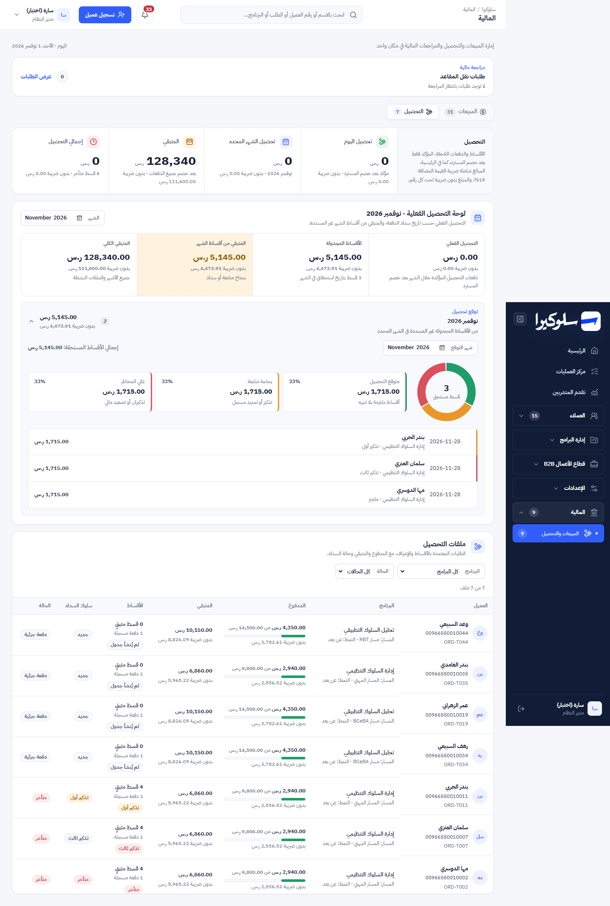
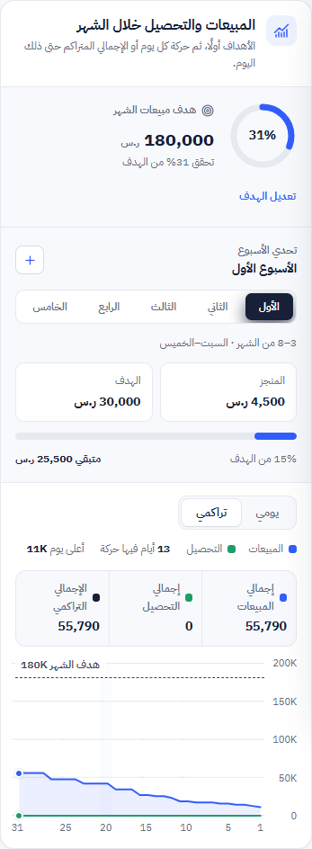

# Charts: shares as percentages

Branch: `design/phase-0-shell`. The user asked for charts that show each section's share as a percentage instead
of plain bars. Same APIs, same numbers. Only the display changed, apart from one invented scale that was removed
(see the reports row).

## Screenshots (synthetic data, October / November 2026)

| | |
|---|---|
| Home, daily (the readout is checked below; it is not in this image)  | Home, cumulative against the target  |
| Trainee distribution  | Reports  |
| Collection forecast (full finance page)  | Cumulative at 375px  |

## What changed

| Where | Before | After | Why |
|---|---|---|---|
| Home: total received | Split bar with amounts | Same split. The legend shows each part's **percentage** with its amount | The share is the point of the split. |
| Home: sales and collections, daily | Thin bars, native title tooltip | Same bars (bars suit daily amounts). A **hover readout** shows the date, sales, collections and total. The hovered day is highlighted | Readable exact values. |
| Home: sales and collections, cumulative | The same bars, summed | **Growth area** for sales and a line for collections. A dashed **monthly target** line with its label. Dots on the last day. The readout adds «x% من هدف الشهر». Lines stop at today | Cumulative is progress towards a target. A flat line after today would read as a stall. |
| Home: trainee distribution | Grey bars scaled to the largest group | **Donut** with the total in the centre. Each programme row has a colour swatch, count and **percentage**, and still expands to its tracks. Hovering a row or a slice shows that share in the centre | Part-to-whole. |
| Reports: registrations by programme | Bars | **Donut** plus a legend: count and percentage. The four largest programmes, the rest as «أخرى» | |
| Reports: workload by department | Bars sized `count × 12%`, so 9 tasks filled the bar | **Donut** plus legend over the real count of open tasks | The old scale was invented. |
| Finance: collection forecast | Three amount cards | **Donut** of the month's due amount (expected / needs follow-up / high risk). Each card shows its percentage and highlights with its slice. The paused (policy) amount stays outside, on its own line | The paused amount isn't part of the forecast. |

## Rules applied

- **Colour follows the entity, never its rank.** One categorical order (`--sk-cat-1…5`, `--sk-cat-other`):
  - Programmes: ABA blue, OBM orange, competency aqua, continuing education yellow. Same on the home page and
    in reports.
  - Departments have their own fixed map.
  - Forecast slices use the status colours (green / amber / red), always with their label.
- **Validated with the dataviz palette check:**
  - Categorical palette: lightness, chroma, colour-blind separation (worst ΔE 9.1) and normal-vision separation
    (worst ΔE 19.6) all pass.
  - Contrast: three slices are under 3:1 on white. That is why every slice has a visible text label, count and
    percentage.
  - Sales vs collections: passes every check.
- **Percentages are rounded one by one.** Equal values always show the same percentage (11 and 11 both read
  31%), so a total can read 99–101%. Largest-remainder rounding was tried and dropped: it showed 31% and 30% for
  the same count.
- Each donut has an `aria-label` listing every share. The cumulative chart's label states the totals and the
  percentage of the target.

## Checks (local copy, synthetic data)

| Check | Result |
|---|---|
| Trainees 8 / 6 / 11 / 21 → 17% / 13% / 24% / 46% | ✅ |
| Reports: 11 / 11 / 8 / 6 → 31% / 31% / 22% / 17%; tasks 3 / 3 / 3 → 33% each | ✅ |
| Cumulative: 55,790 = 31% of the 180,000 target; day 20 readout 42,140 = 23% | ✅ |
| Forecast November: 3 × 1,715 (expected / follow-up / risk) → 33% each, total 5,145 | ✅ |
| Hover readout stays inside the chart on days 1, 15, 31, at 1440 and 375px | ✅ |
| No page-level horizontal scroll at 1440 or 375px on home, reports and finance | ✅ |
| `npm test` | 102 / 102 (1 new test) |
| Lint / type errors | 59 / 100 (unchanged) |

## Not done

- No "before" screenshots were taken for this change. Earlier phase folders show the old charts.
- The weekly challenge bar and the monthly target ring are unchanged: each is already a single ratio against a
  goal.
- The reports page keeps its old card frame (Phase 6).
