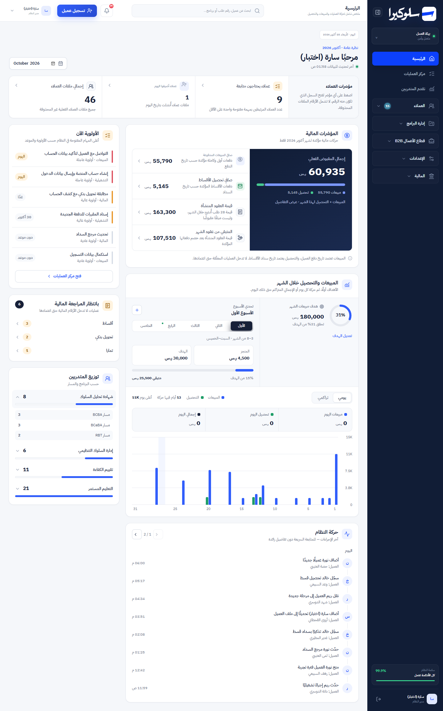
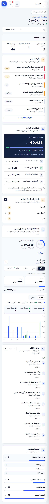
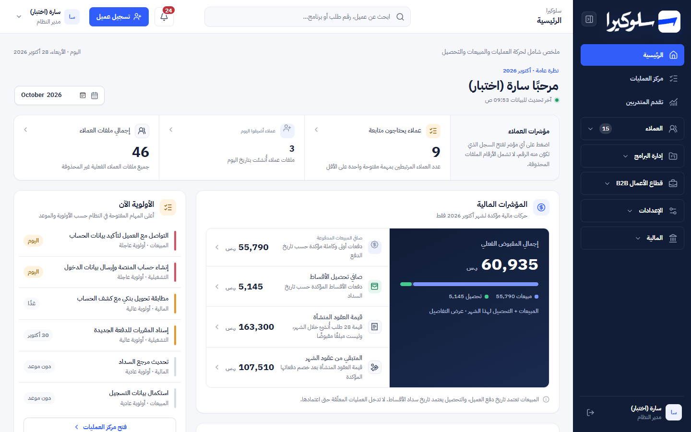
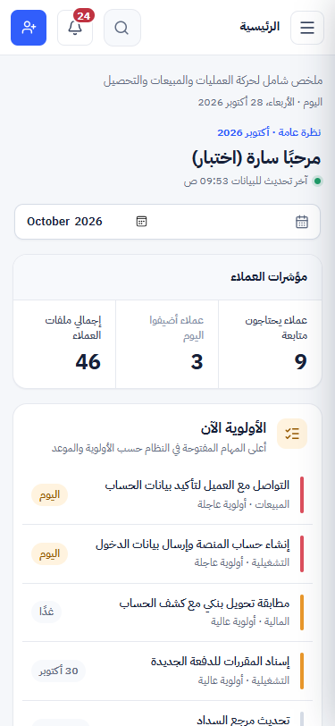

# Phase 0: Shell (sidebar, top bar, page header)

Branch: `design/phase-0-shell`, cut from `design/premium-operations-dashboard` at `ac9335a`.
Scope: the application shell (the `<main className="shell">` markup in `app/page.tsx`) and its CSS. No module content changed.

## Before / after

| | Desktop 1440px | Mobile 375px |
|---|---|---|
| Before |  (dashboard phase, old shell) |  |
| After |  |  |

More in [`screenshots/phase-0/`](screenshots/phase-0/): 768 and 1024px, Finance with keyboard focus on
the sidebar, the collapsed rail, and the mobile menu open. All with synthetic data.

## What changed and why

| Before | After | Why |
|---|---|---|
| "بيئة العمل · متصل وآمن" box and "سلامة النظام · كل الأنظمة تعمل · 99.9%" bar in the sidebar | Removed | Both were fixed text and a fixed number with no data behind them, which breaks the "no invented statistics" rule. |
| Top bar: page name in bold text + 9px description | Breadcrumb (`سلوكيرا / group`) above a real `<h1>` page title | One real page heading per view; the breadcrumb says where the page sits in the menu. "سلوكيرا" goes back to the dashboard. |
| Description squeezed into the top bar, date in a 9px pill | Page header row (`.sk-page-head`): description, then today's date in a `<time>` | Readable at 13 / 12px, and the description is no longer hidden on mobile. |
| Hard-coded hex colours spread across several legacy override layers | One `.shell`-prefixed block on `--sk-*` tokens, plus 6 new navy tokens | One place to change the shell. Legacy layers stay in place until Phase 7 clean-up. |
| 7–10px nav labels, badges, profile, account menu, notifications | 12px floor (meta), 13px body, 16px page title | Readability. Checked in the browser: no visible shell text under 12px at any width. |
| Faint focus outline (`#8da4ff55`), none on most shell controls | `--sk-ring` on light surfaces, new `--sk-ring-inverse` (navy gap + white ring) on the sidebar | Visible keyboard focus everywhere in the shell. |
| Collapsed rail: icon-only buttons with no accessible name | `aria-label` + `title` on each item and group while collapsed | Screen readers and hover tooltips name every icon. |
| Active nav item marked by colour only | `aria-current="page"` on the active item | State not by colour alone. |
| Account button named only by initials when narrow | `aria-label="حساب <name>"` | Accessible name at every width. |
| Mobile menu: "collapse" button overlapped the close (×) button | Collapse button hidden at ≤760px | Pre-existing overlap; collapsing makes no sense in the mobile drawer. |
| Primary button lifted on hover | Darker brand on hover, `scale(.97)` on press | Matches the motion rules in `DESIGN-SYSTEM.md`. |

## Functional preservation

`git diff --stat design/premium-operations-dashboard` touches only `app/page.tsx` (shell JSX),
`app/globals.css`, one new test, and these docs. No API, permission, schema or business-logic change.
Navigation (`canOpen`, `visibleNavGroups`, `go`), search, notifications, account menu, logout and
sidebar collapse are unchanged in behaviour.

Removed CSS: the `.workspace`, `.health`, `.page-date` and `.topbar-page b/span` rules, which matched only
the removed markup (each class appears nowhere else in `app/`). The test regex on
`.nav-group:not(.expanded):not(.static) .nav-group-items>button{height:0!important` is untouched.

## Checks

| Check | Baseline (dashboard branch) | Phase 0 |
|---|---|---|
| `npm test` | 80 / 80 | **81 / 81** (1 new shell test) |
| `npx eslint app/page.tsx` | 30 errors, 32 warnings | 30 errors, 32 warnings (all pre-existing) |
| `npx tsc --noEmit` errors in `page.tsx` | 20 | 20 |

Verified in the running app (local preview copy, synthetic data, headless Edge):

| Check | Result |
|---|---|
| No page-level horizontal scroll at 375, 768, 1024, 1440px | ✅ |
| No visible shell text under 12px at those widths, or with the mobile menu open | ✅ |
| `h1` and breadcrumb follow the view (Dashboard: `سلوكيرا`; Finance: `سلوكيرا / المالية`) | ✅ |
| Keyboard focus on a sidebar item shows the inverse ring | ✅ |
| Collapsed rail: every visible item has an accessible name | ✅ |
| Mobile menu opens with no overlapping controls | ✅ |
| Role matrix, shell only: admin, sales, finance and academy each see only their permitted groups; "تسجيل عميل" only for admin; no horizontal scroll | ✅ |

## Known limits

- **b2b and viewer roles not checked:** the synthetic seed has no accounts for them. Their menus come from the
  same unchanged `canOpen` logic.
- **Finance shows "تعذر تحميل البيانات" in the local preview:** `/api/finance` returns 500 there. This is the
  local schema, which was built from the `drizzle/` migrations only. The API isn't part of this diff.
- **Local setup changed:** the tables weren't created by opening the page, so the drizzle `.sql` files were
  applied to the local D1 file before seeding (see HANDOFF).
- **Not checked** on a real phone, in Safari, or with a screen reader.
