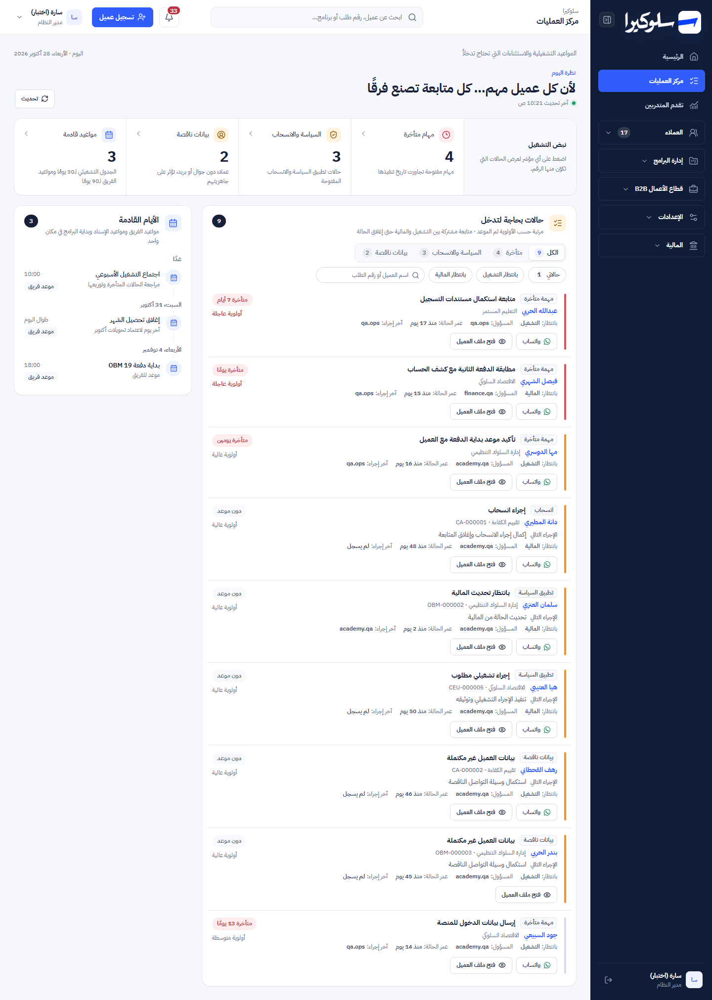
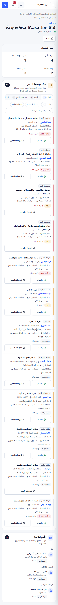

# Phase 1: Operations Center

Branch: `design/phase-0-shell` (the user chose to keep Phase 1 on the same branch, on top of Phase 0).
Scope: `LiveWork` in `app/page.tsx` (the "مركز العمليات" view) and its CSS. Same API, same data.

## Before / after

| | Desktop 1440px | Mobile 375px |
|---|---|---|
| After |  |  |

More in [`screenshots/phase-1/`](screenshots/phase-1/): 768 and 1024px, the empty state when no case
matches the filter, and the academy view. All with synthetic data.

## What changed and why

| Before | After | Why |
|---|---|---|
| Navy banner, then 4 coloured stat cards with no actions | Masthead (daily message, last update, **Refresh** button) and a **pulse ribbon** with 4 counts | Same counts from `data.stats`. Each count now filters the queue to the cases behind it, and "مواعيد قادمة" scrolls to the agenda. |
| "مواعيد قادمة · خلال 30 يومًا" | "الجدول التشغيلي لـ30 يومًا ومواعيد الفريق لـ90 يومًا" | The old label was wrong: the API counts team events up to 90 days ahead. |
| Team events and the operational schedule in two separate boxes | One **agenda** ("الأيام القادمة") grouped by day (today / tomorrow / weekday), with team events and assignments/programme starts on one timeline; "عرض كل المواعيد" past 8 items | One place to see what's coming. Built from `data.events` and `data.schedule`. |
| Heavy cards per case, 7–9px text, in API order | **Priority queue**: priority marker, case type, title, customer (button), programme · order, next action, meta (waiting for / owner / case age / last action), due chip ("متأخرة 7 أيام", "اليوم", "دون موعد"), actions | Readable at 12–14px. Sorted by priority (urgent first), then case type, then due date. |
| No filters | **Segmented control** (all / overdue / policy and withdrawal / incomplete data), each with a live count, plus chips **حالاتي**, **بانتظار التشغيل**, **بانتظار المالية**, and a search box (name, order number, programme, phone) | Narrows the list using fields the API already returns. Says when nothing matches and offers "مسح التصفية". |
| Any action error or refresh replaced the whole page with a loading/error message | Skeleton on first load only. Refreshes keep the list on screen (dimmed, `aria-busy`). Errors show inline above it | No lost context. |
| Clicking anywhere on a card opened the customer; nested buttons inside a clickable card | Row click still opens the customer (mouse), and the customer name is a real button for keyboard users | Keyboard access without changing the existing behaviour. |
| — | Footnote when a case type reaches 50 items | The API returns at most 50 cases per type. The page now says so instead of implying the list is complete. |

Also fixed: a legacy sidebar rule `.brand span{font-size:10px}` (and `.brand b{18px}`) also hit every
`HomeMetric` with `tone="brand"` (they get the class `brand`). On the dashboard, "عملاء أضيفوا اليوم" and
"صافي المبيعات المدفوعة" had a 10px label and an 18px value instead of 13px / 30px. Those legacy rules
are now scoped to `.sidebar>.brand`.

## Functional preservation

API, permissions, schema and business logic are unchanged. The data loading, `takeAttentionAction`, the
WhatsApp link, `openCustomer`, `routeFor`, `waitingFor` and `nextAction` are the same code. The test
assertions on `customer-actionable`, "فتح ملف العميل" and `.operations-exceptions article.customer-actionable`
still pass against the new markup.

Removed CSS: 146 rules that matched only the old markup (`operations-command`, `operations-center-stats`,
`team-events-board`, `team-event-cards`, `operations-schedule`, `exception-*`, and the old
`operations-exceptions` styles). A script checked each class was unused in `app/page.tsx` first.
`team-event-form` and `team-events-admin`, which the control panel uses, are untouched.

## Checks

| Check | After Phase 0 | Phase 1 |
|---|---|---|
| `npm test` | 81 / 81 | **82 / 82** (1 new test), **84 / 84** with both API fixes |
| `npx eslint app/page.tsx` | 30 errors, 32 warnings | 30 errors, 31 warnings (no new findings) |
| `npx tsc --noEmit` errors in `page.tsx` | 20 | 20 |

In the running app (local copy, synthetic data, headless Edge):

| Check | Result |
|---|---|
| Queue shows every case type: overdue task, withdrawal, policy, waiting for finance, incomplete data | ✅ |
| Order: urgent first, then case type, then due date; due chips read "متأخرة 7 أيام", "متأخرة يومين", "دون موعد" | ✅ |
| "بيانات ناقصة" in the pulse → queue filtered to 2 cases | ✅ |
| "بانتظار المالية" chip → 4 cases, segment counts update | ✅ |
| Search with no match → empty state; "مسح التصفية" restores all 9 | ✅ |
| Customer name opens the customer drawer | ✅ |
| Agenda merges team events and schedule, grouped by day | ✅ |
| Roles: sales doesn't see the finance-department overdue task (8 cases) and sees only events meant for everyone; finance sees 9; academy sees the "تم اتخاذ الإجراء" buttons | ✅ |
| No horizontal scroll and no text under 12px at 375, 768, 1024, 1440px | ✅ |
| "تم اتخاذ الإجراء" as academy | Before the fixes: 403 (a bug that predates this phase). After them: policy case → `waiting_finance` ✅, withdrawal → `closed` and gone from the list ✅ |

## Suggestions (need a decision, not done)

These need API, permission or product changes, which are outside this phase's rules:

1. ~~**"تم اتخاذ الإجراء" doesn't work for anyone (bug).**~~ **Fixed after the user approved it** (separate commit).
   `POST /api/operations-center` now calls `authorize(req, ["academy"])`. Checked against the local copy:
   academy moves a policy case to `waiting_finance` (200), a repeat is refused (409), sales gets 403, and
   academy still gets 403 when creating team events, which stay admin-only.
1b. ~~**A closed withdrawal case never leaves the list.**~~ **Fixed after the user approved it** (separate commit).
   Withdrawals registered through Finance get a `finance_resolved` follow-up, so closing one did save
   `closed`. But the GET query listed withdrawals whatever their state (`w.id IS NOT NULL OR …`), so the case
   stayed, and a second click got 409. The query now skips `closed` follow-ups, and the close step is an
   upsert, so a withdrawal with no follow-up row (recorded before that hand-off existed) closes too. Checked
   locally: both kinds close (200), a repeat is refused (409), and both leave the list.
2. **Customer drawer → side sheet with a journey timeline:** left for Phase 2. The same drawer serves the
   Customers page, so it should be redesigned once with the customer profile.
3. **Names instead of email prefixes:** "المسؤول" and "آخر إجراء" show `academy.qa`. The API could join
   `staff_accounts.display_name`.
4. **Due-today tasks are missing:** the API only returns tasks with `due_at` before today, so today's
   tasks never appear. Add them as a "مستحقة اليوم" group.
5. **Close an overdue task from the queue:** today only policy cases have an action button.
6. **Admin shortcut "إدارة المواعيد":** needs the control panel to accept an initial tab.
7. **The 50-per-type cap:** add paging or raise the limit if the team regularly goes past it.
8. **Same window for upcoming items:** the schedule looks 30 days ahead and team events 90.
9. **Dead route:** for a case with no customer, `routeFor` can send the user to the `reservations` view,
   which is no longer rendered (blank page).
10. **Dead code:** `LegacyLiveWork` isn't used anywhere. Remove it in Phase 7.

## Known limits

- The synthetic seed had no events, policy cases or incomplete-data cases. A local-only add-on script inserted
  them for this check (not committed).
- The academy screenshot shows the inline 403 message from suggestion #1.
- Not checked on a real phone, in Safari, or with a screen reader.
