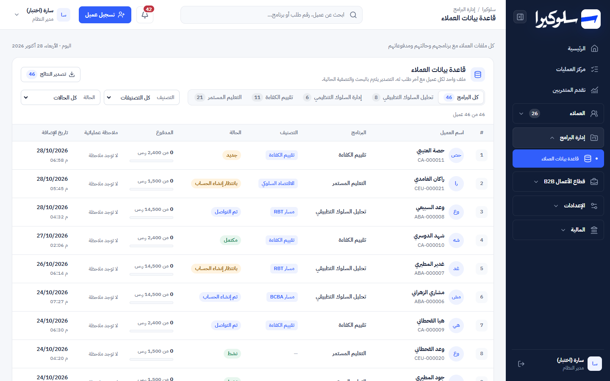
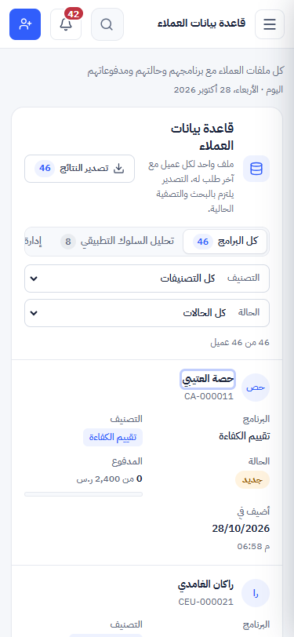
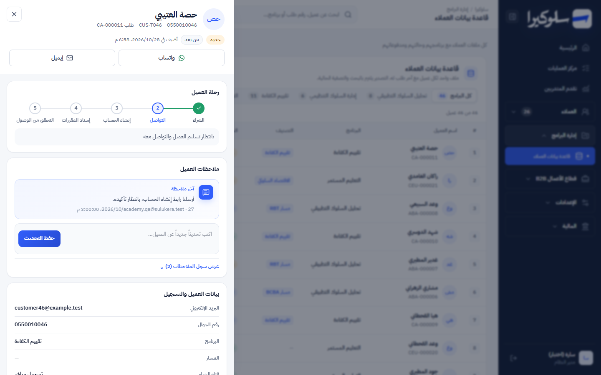
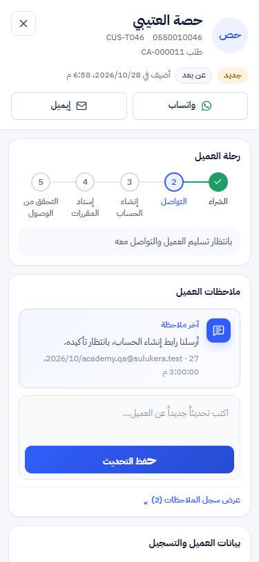

# Phase 2: Customers

Branch: `design/phase-0-shell` (same branch as Phases 0 and 1, at the user's request).
Scope: `LiveCustomers`, `CompletedCustomerTable` and the customer file opened from the customers page
and from the Operations Center (`app/page.tsx`), plus their CSS. Same API, same data.

## Screenshots

| | Desktop 1440px | Mobile 375px |
|---|---|---|
| Directory |  |  |
| Customer file |  |  |

768 and 1024px are in [`screenshots/phase-2/`](screenshots/phase-2/). Synthetic data only.

## What changed and why

### Directory

| Before | After | Why |
|---|---|---|
| 4 summary cards: total, results shown, number of programmes, number of classifications | Removed. The result count sits under the filters ("8 من 46 عميل"), and the header keeps the export button with its count | Two of the four cards answered nothing an operator needs. |
| Two dropdowns (programme, classification) in a separate filter box | **Programme segment** with a live count per programme, plus **classification** and a new **status** dropdown | Status (`academy_status`) is the question people ask most ("who's waiting for an account?"). It was already in the API response. |
| 6 columns at 7–10px, row click only | 8 columns at 12–13px: name (a real button), programme + cohort, classification chip, **status chip**, **paid vs. order value with a bar**, operational note, date added. Sticky header inside the table | Status and payment were already returned for every row but never shown. Keyboard users can open a file. |
| Date rendered as "282026/10/" | "28/10/2026" | The Arabic locale adds direction marks that `dir="ltr"` scrambled. |
| Topbar search didn't match order numbers, though its placeholder offers it | Search also matches the order number | The placeholder promised it. |
| Page description: "العملاء الذين اكتملت رحلتهم التشغيلية" | "كل ملفات العملاء مع برنامجهم وحالتهم ومدفوعاتهم" | The list holds every customer, not only completed ones. |
| Mobile: wide table | Each customer becomes a card with labelled fields. Empty notes are hidden | No horizontal scrolling and nothing to decode. |
| CSV export | Same rows and columns, plus "الحالة" | Matches what's now on screen. |

### Customer file (suggestion #2 from Phase 1)

| Before | After | Why |
|---|---|---|
| Dark gradient header, then a stack of boxes | **Header**: avatar, name, phone (LTR), customer and order ids, status chip, delivery, date added, then WhatsApp and email | Who, what state, how to reach them, in one glance. Email is disabled when hidden by permission. |
| "حالة العميل" box with generic help text | **Customer journey**: الشراء → التواصل → إنشاء الحساب → إسناد المقررات → التحقق من الوصول, with the current step marked and what happens next | Built from the order's `academy_status`, which `enrollments/transition` updates on every step. Withdrawn, trial and unknown statuses fall back to the plain status line instead of a guessed step. |
| Data as a 2-column grid of boxes | Data as a **ledger** (label left, value right). The cohort editor and "تعديل بيانات العميل" are unchanged | Easier to scan. Same editors and the same PATCH. |
| Finance: value and paid, with a bar | **Ledger**: order value, paid, **remaining**, seat fee, total actually paid, then a bar with "x% من قيمة البرنامج مدفوع" | Remaining is `total − paid` from the same fields. No new figures. |
| "آخر النشاطات" | "سجل تعديل البيانات" | That section only lists data edits, so the old title promised more than it showed. |
| Notes, editors and delete dialog at 8–10px. On mobile, "حفظ التحديث" had invisible text (a legacy `.primary{font-size:0}` rule) | 12–13px floor inside the file. The save button is readable on mobile | Readability. That mobile bug existed in the old drawer too. |

The file also opens from the Operations Center. There it gets no `journeyStatus`, so it shows the case and its
status line instead of a journey.

## Functional preservation

The API, permissions, schema and business logic are unchanged. The customer load, `open`, the WhatsApp message,
the notes POST, the cohort/data PATCH, the edit history, the admin delete and the Escape-to-close behaviour all
use the same code. The `CustomerSmartFilters` component is untouched, since 5 other screens use it.

Removed CSS: 18 rules and 23 selectors that only targeted `.customer-drawer`, which nothing renders any more.
The shared `.operations-drawer` rules (finance, reservations) are kept.

## Checks

| Check | Before Phase 2 | After |
|---|---|---|
| `npm test` | 86 / 86 | **87 / 87** (1 new test) |
| `npx eslint app/page.tsx` | 30 errors, 31 warnings | 30 errors, 31 warnings |
| `npx tsc --noEmit` errors in `page.tsx` | 20 | 19 (one existing error went away: `orderId` is now typed where it's read) |

In the running app (local copy, synthetic data with statuses spread across the whole journey, headless Edge):

| Check | Result |
|---|---|
| 46 customers listed; programme counts 8 / 6 / 11 / 21 | ✅ |
| Programme segment → 8; + status "نشط" → 2; "مسح التصفية" → 46 | ✅ |
| Name button opens the file; journey shows step 2 as current for status "جديد" with the right next step | ✅ |
| Escape closes the file | ✅ |
| No horizontal scroll, no text under 12px on the page or in the file at 375, 768, 1024, 1440px | ✅ |
| Roles: sales and academy see the directory; finance doesn't (no `customers.view`, unchanged) | ✅ |

## Known limits

- The journey can't show steps for direct-activation programmes differently: they go from "تم إنشاء الحساب"
  straight to "مكتمل", so all five steps show as done.
- The ledger shows the customer's latest order only, as the API returns one order per customer. A full order and
  payment history needs the finance data per customer (suggestion for later).
- The old demo components `Customers` and `CustomerTable` aren't rendered anywhere. Remove them in Phase 7.
- Not checked on a real phone, in Safari, or with a screen reader.
