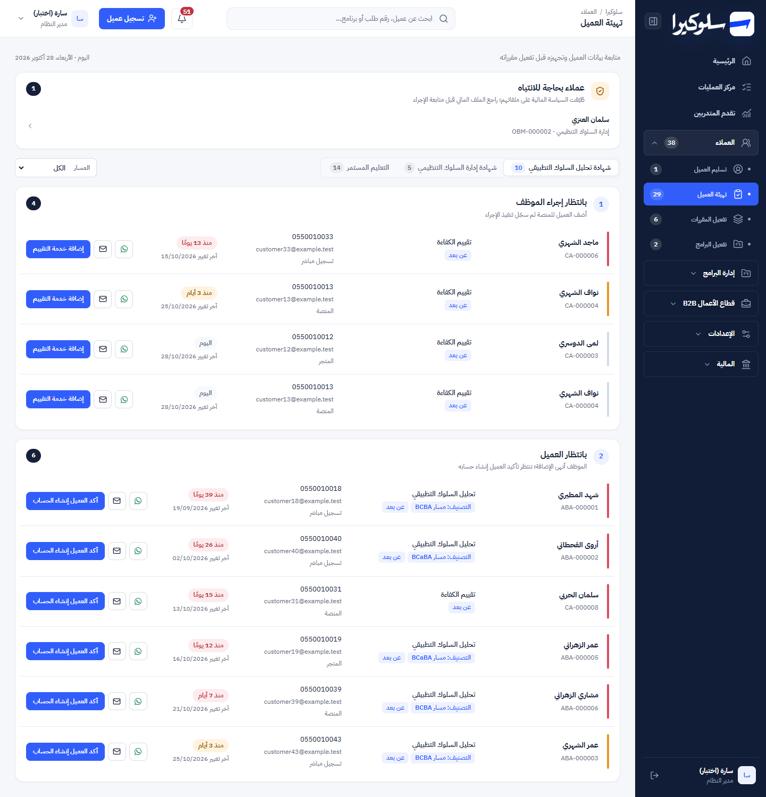
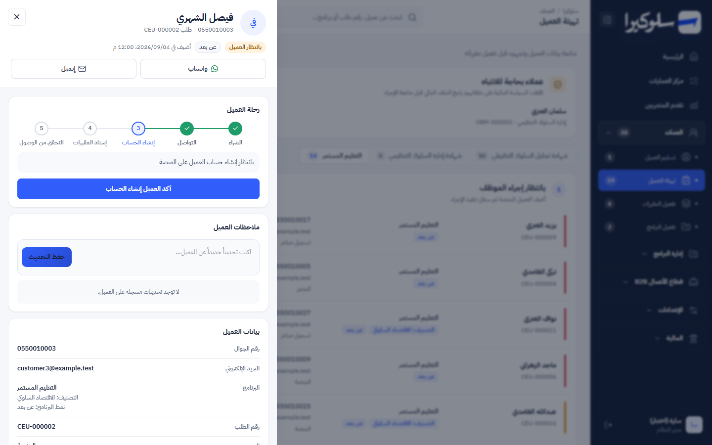
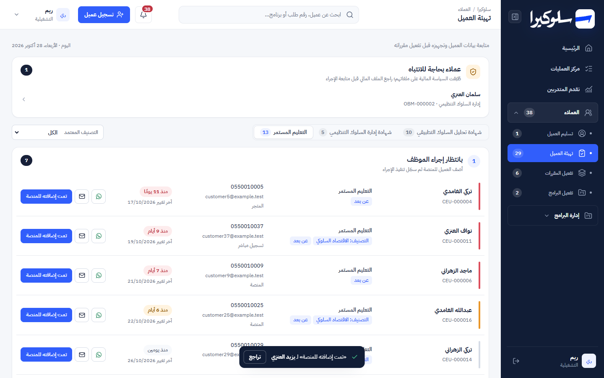
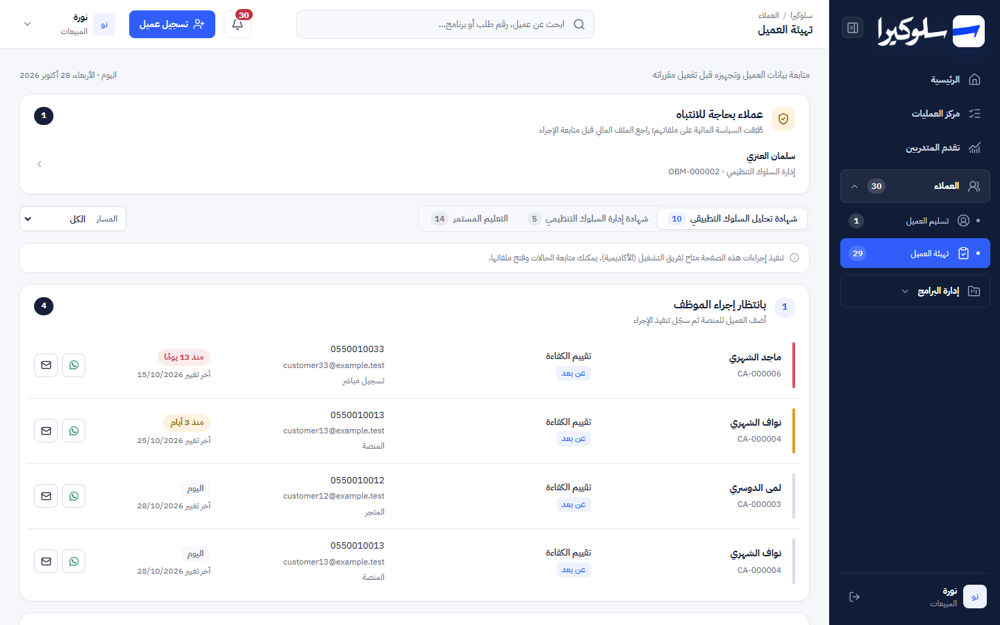
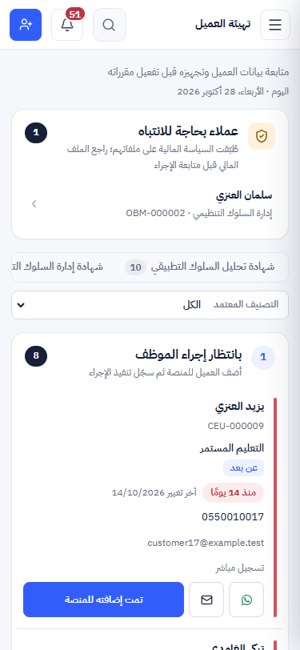

# Phase 3: Academy flows (onboarding first)

Branch: `design/phase-0-shell` (same branch as Phases 0–2).
Scope: `LiveAcademy`, its row component and its customer file in `app/page.tsx`, plus CSS. The user asked
to fix everything found in the review of "تهيئة العميل". That page shares one component with "تفعيل المقررات"
and "تفعيل البرامج", so all three pages get the fixes and the new layout. No API, permission or schema change.

## Screenshots

| | |
|---|---|
| Onboarding, desktop |  |
| Customer file (waiting for account) |  |
| Undo after a move |  |
| Sales (read-only) |  |
| Mobile |  |

Also in [`screenshots/phase-3/`](screenshots/phase-3/): 1024px, "تفعيل المقررات" and "تفعيل البرامج". All with synthetic data.

## Bugs fixed

| # | Bug | Fix |
|---|---|---|
| 1 | Anyone with `customers.manage` (new staff default to sales with it) saw every action button. But `POST /api/enrollments/transition` accepts academy and admin only. A sales click returned "ليس لديك صلاحية لتنفيذ هذا الإجراء", and the whole board disappeared | `canAdvance` = admin or academy, the same rule as the API. Everyone else gets a read-only queue with a note: "تنفيذ إجراءات هذه الصفحة متاح لفريق التشغيل (الأكاديمية)". |
| 2 | "مراحل العملية" in the file showed all three steps as pending for every customer in "بانتظار إنشاء الحساب" (the status was missing from the stage list) | The file uses the same 5-step journey as the customer file from Phase 2 (`customerJourneyStages`), which includes that status. |
| 3 | Any error, and every reload after an action, replaced the page with a loading/error message | Skeleton on first load only. Reloads keep the list (`aria-busy`). Errors show inline above it. |
| 4 | Competency-assessment customers in the ABA tab had "تمت إضافته للمنصة" on their button, while the API sends them to "ربط المقيم" | The button says "إضافة خدمة التقييم" for them, the label the code already had. |

## Usability

| # | Problem | Change |
|---|---|---|
| 5 | "عملاء بحاجة للانتباه" listed customers from any stage (one was already "نشط") | Only customers who are in this page's columns. |
| 6 | One click moved a customer, with no way back | The move waits 6 seconds with a "تراجع" toast and is only sent afterwards. Leaving the page or closing the tab sends it at once (`keepalive`). No API change. |
| 7 | Only a small "آخر تحديث" date | An age chip ("منذ 13 يومًا"): amber from 3 days, red from 7, with a matching side marker. Each column lists the oldest case first. |
| 8 | The page never refreshed on its own | Refreshes on `sulukera:data-changed`, when the tab becomes visible, and every 60 seconds while visible. It skips refreshes while a move is waiting for undo. |

## Layout

- Each column is a panel: step number, title, one-line purpose, count.
- Each customer is one row with no repeated column labels: name (a button) and order, then programme with
  classification / note / delivery / competency chips, then contact and source, then age, then actions.
  Rows become stacked cards on mobile.
- Programme tabs use the segmented control with live counts. The track/classification filter now shows on
  the onboarding page too.
- The customer file uses the Phase 2 sheet: identity, stage chip, contact, journey with the next action,
  notes, a data ledger and the payment reference.
- The shared filter box (`CustomerSmartFilters`) on "تفعيل المقررات" and "تفعيل البرامج" is restyled on tokens
  inside these pages only.
- Text floor 12px. The old page had 207 text elements under 12px.

## Functional preservation

The data load, the transition calls and their action names, the direct-programme routing, the track filters,
the WhatsApp message, the notes and the payment-reference editing are all unchanged. The only behaviour change
is the 6-second undo window before a move is sent.

Removed CSS: 248 rules (about 27 KB) that matched only the old board, rows, attention box, assignment banner
and drawer pieces. `.operations-drawer .detail-contact` stays: a test pins it, and other drawers share
`.operations-drawer`.

Test changes: four assertions in "organizes onboarding by certificate…" pinned old layout CSS
(`.journey-board.registration…`). They now check the new board. The rest of that test (tabs, column titles,
button labels, transitions) is unchanged. One new test covers the fixes above.

## Checks

| Check | Before | After |
|---|---|---|
| `npm test` | 87 / 87 | **88 / 88** |
| `npx eslint app/page.tsx` | 30 errors, 31 warnings | 30 errors, 31 warnings |
| `npx tsc --noEmit` errors in `page.tsx` | 19 | 19 |

In the running app (local copy, synthetic data):

| Check | Result |
|---|---|
| Admin: 3 tabs with counts 10 / 5 / 14; columns "بانتظار إجراء الموظف" and "بانتظار العميل"; oldest first | ✅ |
| File for a customer in "بانتظار إنشاء الحساب": steps done, done, current; button "أكد العميل إنشاء الحساب" | ✅ |
| Academy: click → row hidden + undo toast; "تراجع" → row back, status unchanged in the database | ✅ |
| Academy: click and wait → status moves "تم التواصل" → "بانتظار إنشاء الحساب" in the database | ✅ |
| Sales with `customers.manage`: no action buttons, read-only note shown | ✅ |
| Attention box lists the onboarding customer only (the "نشط" one is gone) | ✅ |
| "تفعيل المقررات" (6) and "تفعيل البرامج" (2) render with the new board | ✅ |
| Escape closes the file; no horizontal scroll and no text under 12px at 375, 1024, 1440px | ✅ |

## Needs a decision

- **Academy needs `customers.manage` to open these pages.** The menu shows "تسليم العميل" and "تهيئة العميل"
  only to `customers.manage`. The synthetic academy account had only `customers.view`, so it couldn't open the
  page it's meant to work in. Check that real academy accounts have `customers.manage`. Otherwise the menu
  rule should also allow the academy role.
- "تسليم العميل" (contact) renders a different screen (`TrialHandoff` + `Registration`), not this board. It's
  untouched and stays for later in Phase 3.

## Known limits

- The age is based on `enrollments.updated_at`, which also changes on edits that aren't a stage move. It reads
  "آخر تغيير", not "time in stage".
- If the browser crashes during the 6-second undo window, the move isn't sent. A normal close or navigation sends it.
- Not checked on a real phone, in Safari, or with a screen reader.
