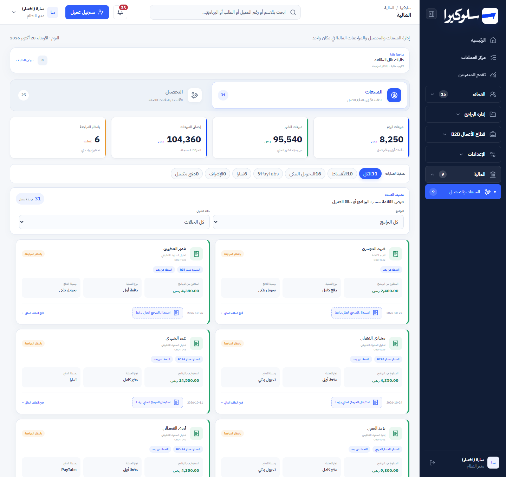
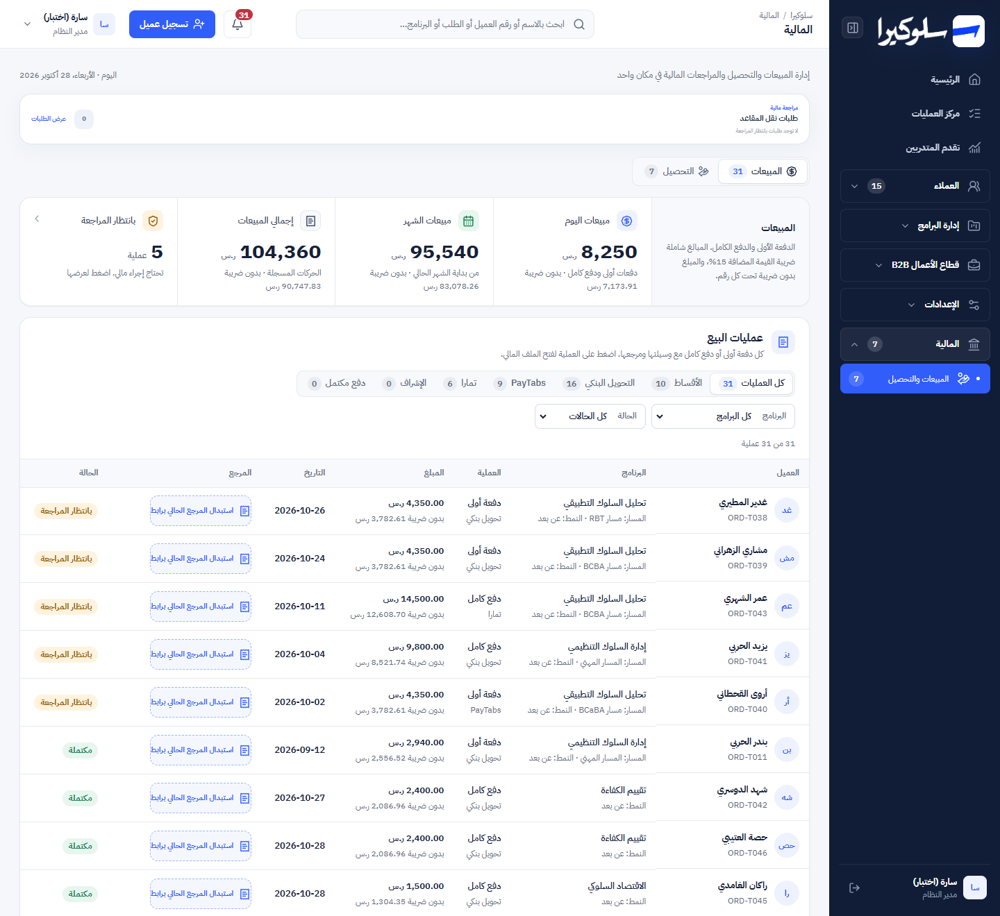
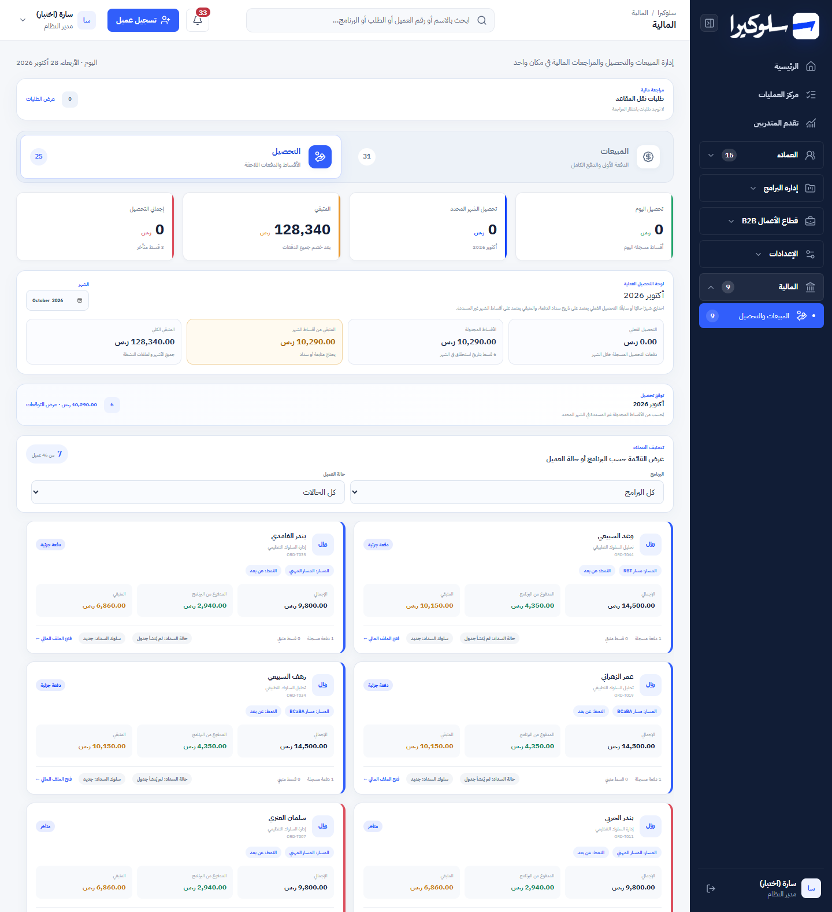
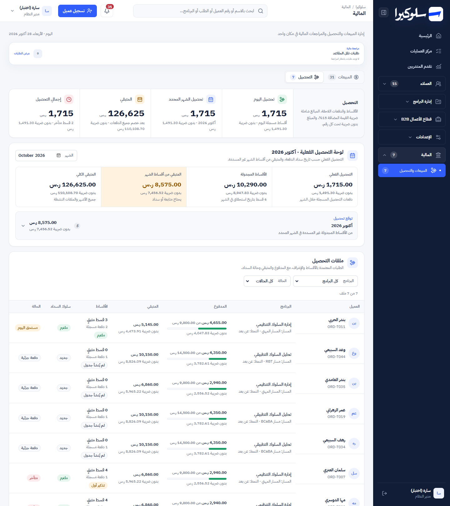
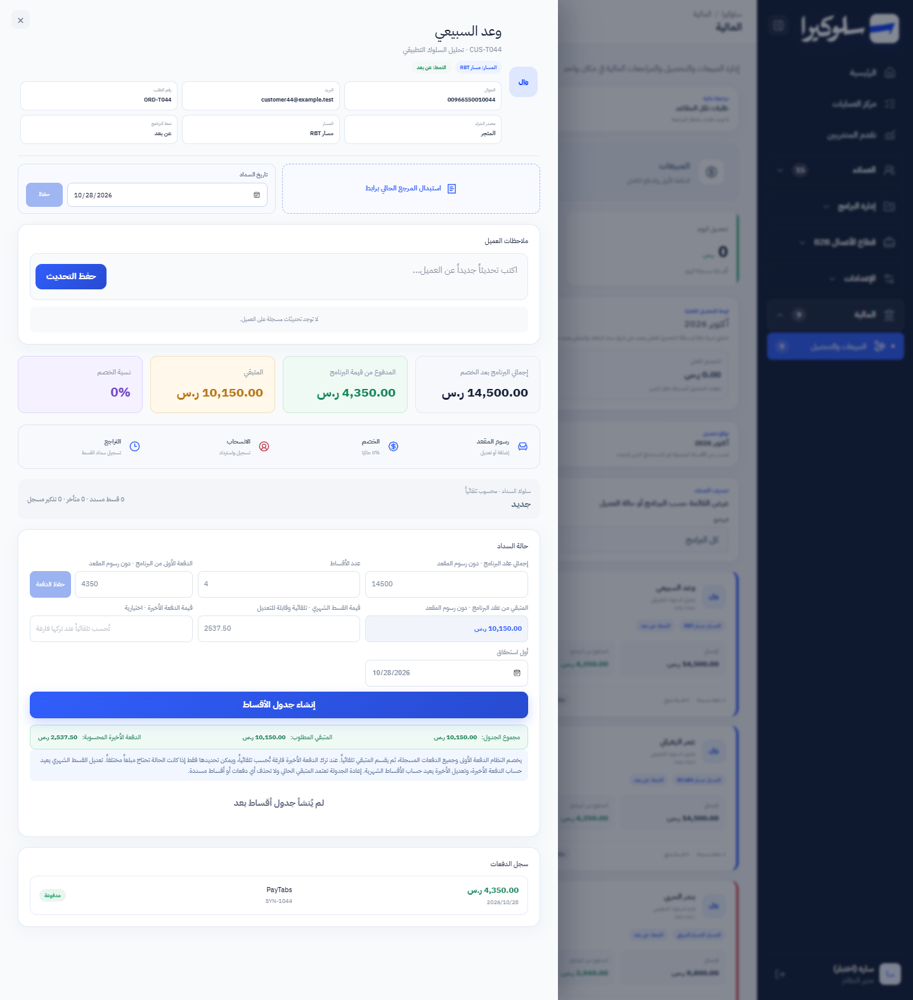
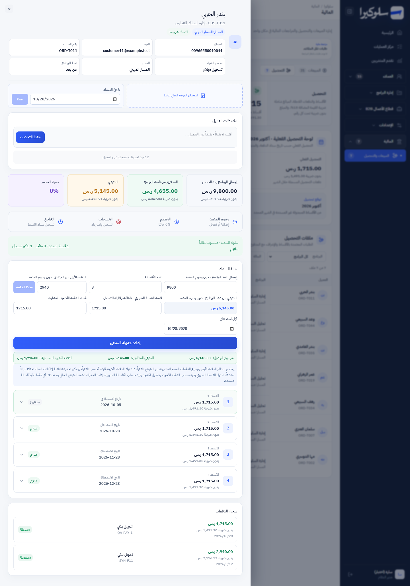
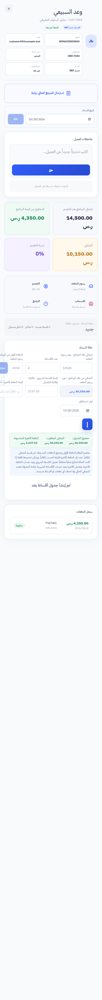
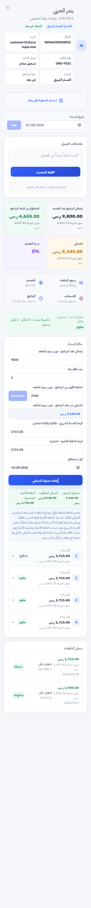

# Phase 4: Finance

Branch: `design/phase-0-shell`. Scope: `LiveFinance` (the «المبيعات والتحصيل» page and the finance file it opens)
in `app/page.tsx`, plus its CSS. Same API, same data, same actions. The user also asked for amounts before and after
VAT. Every amount in the system includes 15% VAT, so the screen shows it as stored and puts the amount before VAT
(`withoutVat()`, ÷ 1.15) under it.

## Screenshots

| | Before | After |
|---|---|---|
| Sales, 1440px |  |  |
| Collections, 1440px |  |  |
| Finance file, 1440px |  |  |
| Sales, 375px |  |  |
| Finance file, 375px |  |  |

Synthetic data only. The "before" file shows an order without a schedule. The "after" file shows one with
installments, after the end-to-end payment check below.

## What changed and why

### Finance page

| Before | After | Why |
|---|---|---|
| Two large tab cards | **Segmented tabs** «المبيعات / التحصيل» with counts | Same switch, a fraction of the height. |
| Collections tab badge counted every order with a balance (25) while the list showed only approved installment and supervision files (7) | The badge counts the files the tab lists | The number promised rows that weren't there. |
| 4 separate KPI cards | **Metric ribbon** (the Operations Center pattern). Each money figure shows the amount before VAT. «بانتظار المراجعة» is a button that filters the list to pending sales | Same figures from the same code. The pending count now leads straight to the work. |
| Collections month and forecast as two separate boxes at 8px | One **month panel**: actual collection, scheduled installments, remaining this month, total remaining (each with before-VAT), and the **forecast** as a collapsible row under it | Same calculations, one place to change the month. |
| Review-type pills, then a separate "smart filters" box, then a count box | One filter row: review-type **segment** with counts (sales), programme and status selects, and a result line with «مسح التصفية» | The same three filters, readable, with a way back. |
| Two-column grid of large cards at 7–10px | **Table** (the customers pattern, sticky header). Sales: customer, programme and track, operation and method, amount + before VAT (+ seat fee), date, editable reference, status chip. Collections: customer, programme, paid of total with a bar + before VAT, remaining + before VAT, installments left with payment state, payment behaviour, status | Ten times the rows per screen and every field labelled. The reference editor works in place without opening the file. |
| Phone: stacked cards | Each row becomes a labelled card (same as customers). No horizontal scroll | |

### Finance file

The structure, controls and every action stay as they were: approve review, payment date, reference, seat fee,
discount, withdrawal, undo, schedule, installments, reminders and history. Changes:
- **Before-VAT amounts** under total, paid, remaining, seat fee, total actually paid, each installment, and each
  payment in the history.
- **Readability:** design-system tokens and a 12px minimum. It was 7–11px.
- **Accessibility:** the file is a labelled dialog (`role="dialog"`, `aria-modal`), and the close button has a
  label.
- **Two fixes on phones:**
  - A legacy rule (`.primary{font-size:0}`) hid the text of «حفظ التحديث» and «إعادة جدولة المتبقي». Phase 2
    fixed the same bug in the customer file.
  - The schedule form kept three 120px columns and overflowed the file by 36px.

The file was restyled, not restructured. Turning it into the customer-file layout (masthead, ledger, timeline) is
left for a later pass. The tests pin many of its class names and every control carries money logic.

## Functional preservation

API, permissions, schema and business logic are unchanged. All finance calculations (`financeStatus`,
`saleStatus`, review types, schedule maths, forecast, month totals) are the same code. Only the markup that renders
them changed. `CustomerSmartFilters` is untouched because other screens still use it. The `TransferReviews` card
above the page is unchanged.

Removed CSS: 135 rules (164 selectors) that only targeted the old cards, tabs, KPI row, filters and collection boxes.
7 shared rules lost only their dead selectors. The customers table rules now also cover finance through
`:is(.ops-customers,.ops-finance)`, so there's no copy.

## Checks (local copy, synthetic data, headless Edge and the browser pane)

| Check | Result |
|---|---|
| Sales: 31 operations. Review filter «تمارا» 6 rows = its badge. «مسح التصفية» back to 31 | ✅ |
| «بانتظار المراجعة» metric → 6 rows, all pending | ✅ |
| Topbar search by order number → 1 row and the result line names the search | ✅ |
| Reference cell: opens its editor without opening the file. Name button opens the file | ✅ |
| Approve a pending review from the file → pending 6 → 5 | ✅ |
| Pay installment 1 with reference QA-PAY-1 → paid, in history, remaining 6,860 → 5,145 | ✅ |
| Before-VAT figures (e.g. 9,800 → 8,521.74; 1,715 → 1,491.30) | ✅ |
| No text under 12px on the page or in the file (installment opened), at 1440 and 375px | ✅ |
| No horizontal scroll at 1440 and 375px, page and file | ✅ |
| Roles: admin and finance 200 on `/api/finance`, academy 403 | ✅ (unchanged) |

| | Before Phase 4 | After |
|---|---|---|
| `npm test` | 95 / 95 | **96 / 96** (1 new test) |
| `npx eslint app/page.tsx` | 29 errors, 31 warnings | 29 errors, 31 warnings |
| `npx tsc --noEmit` errors | 101 | 101 |

The synthetic seed now writes `finance_review_status = 'approved'` for orders that need no review (as real
registration does), a first payment for September instalment contracts, and 12 installments (paid, reminded or
late, due today, upcoming). Locally, `/api/finance` fails until one POST to it has created `finance_undo_log`
(production already has the table). The handoff recipe now says so.

## Not done here

- The finance file keeps its old layout (see above).
- The `TransferReviews` card and the finance pages' native month input (shown in the browser's language) are
  unchanged.
- `Kpi` is now used only by the unused demo components (`Dashboard`, `Finance`, `LiveDashboard`). It goes with them
  in the clean-up phase.
