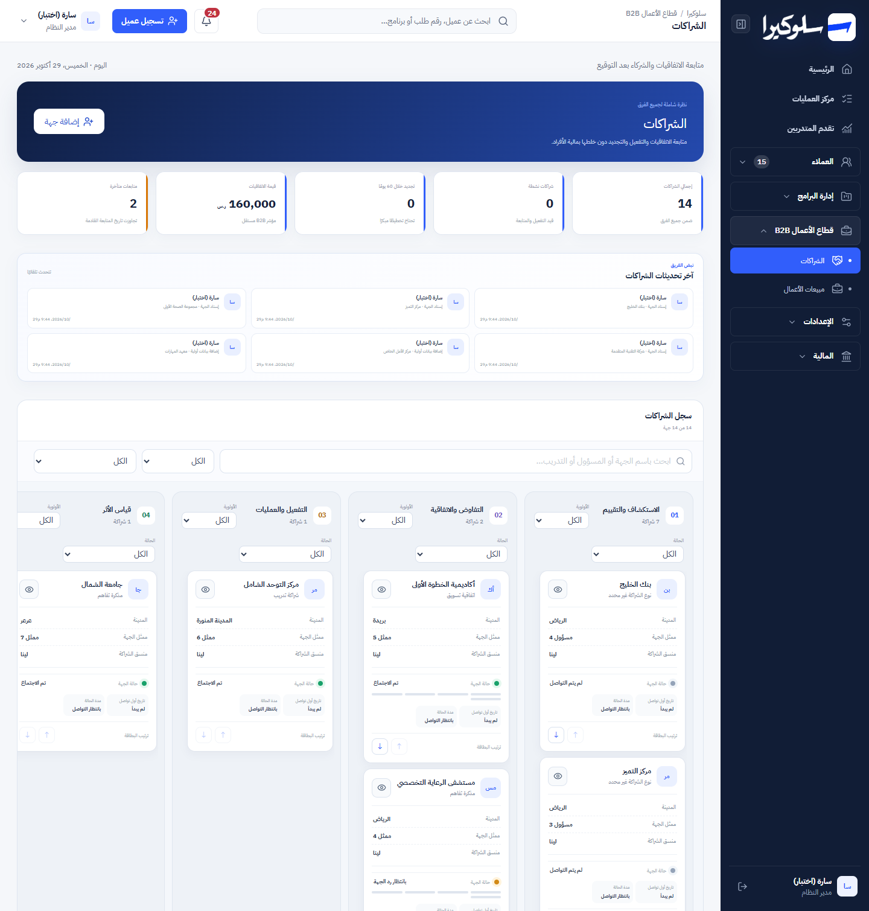
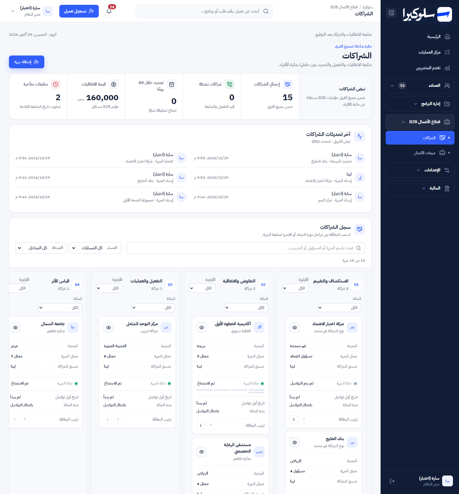
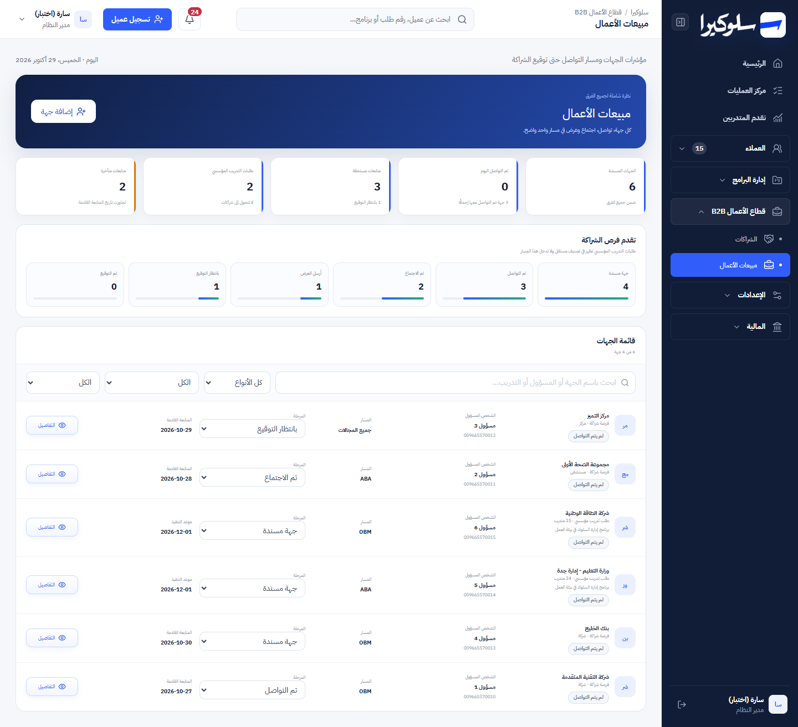
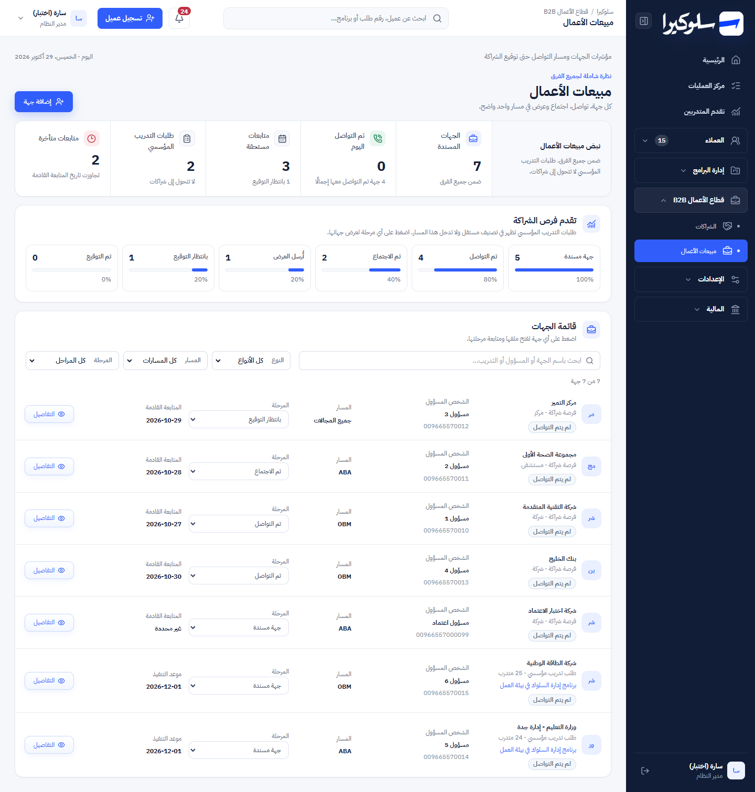
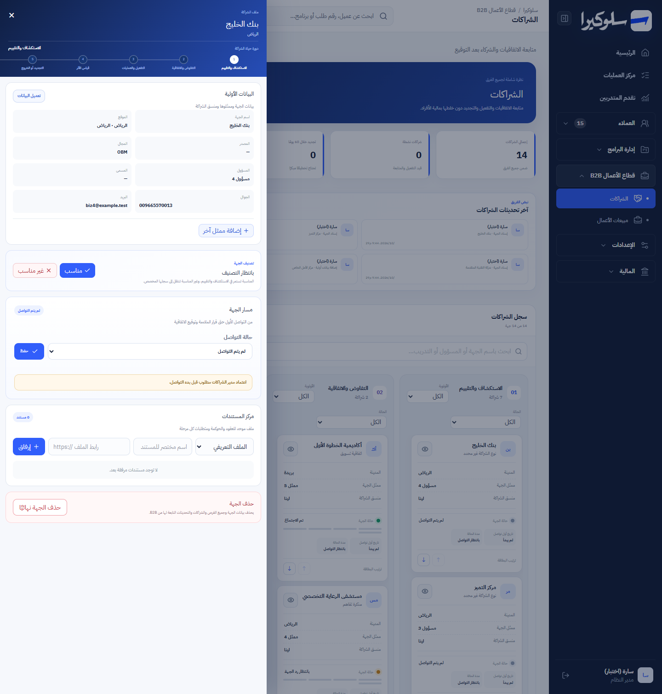
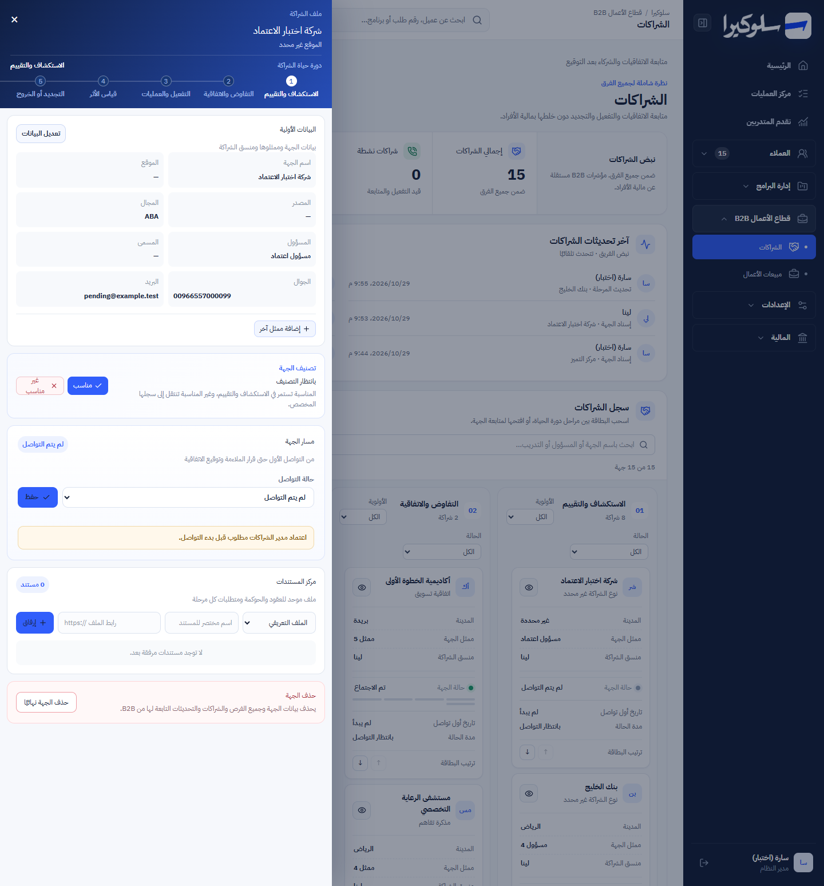
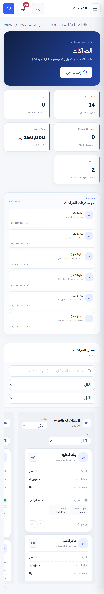
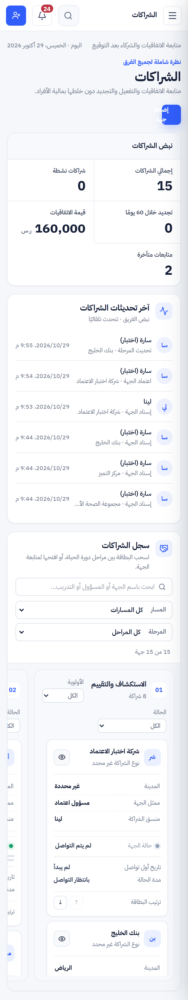

# Phase 5: B2B (part 1: main screens)

Branch: `design/phase-0-shell`. Scope: `B2BWorkspace` in `app/page.tsx` (the «الشراكات» and «مبيعات الأعمال» views)
and its CSS. Same API, same permissions, same actions.

## Screenshots

| | Before | After |
|---|---|---|
| Partnerships, 1440px |  |  |
| Business sales, 1440px |  |  |
| Partner file, 1440px |  |  |
| Partnerships, 375px |  |  |

Synthetic data only. 10 partners across every lifecycle stage and 7 business opportunities were created through
the API. Stages beyond the first were set in the local database, because moving there needs approvals and a
signed agreement.

## What changed

| Before | After | Why |
|---|---|---|
| Dark navy hero card | **Masthead**: scope, title, one line and «إضافة جهة» | Same information, much less height, matching the other pages. |
| 5 separate KPI cards at 8px | **Metric ribbon** with the same five figures and notes. The overdue count turns red when it isn't 0 | Same formulas. |
| Team activity as a grid of boxes at 7–9px | **Feed** in two columns: initials, name, action and organisation, time | Reads in order. |
| Funnel as plain bars | **Funnel steps** with count, bar and percentage. The selected stage is marked (`aria-pressed`) | Clicking a step filters the list, as before. Now you can see which one is active. |
| Toolbar of unlabelled selects | One **filter row**: search plus labelled selects (type, path, stage), and a result line «x من y جهة» with «مسح التصفية» | The same filters. |
| Board and rows at 7–11px | Same board (drag, per-column priority and status filters, reorder buttons) and rows (inline stage, approve/reject), on tokens with a 12px minimum. Card dates are label/value rows, because at 12px the old three-column boxes wrapped | No behaviour change. |
| Partner file, add form and business file at 6–11px | **12px minimum** through 127 generated overrides. Each reuses a legacy selector under `.ops-b2b` and changes only `font-size`, so the layout is untouched. The «غير مناسب» button no longer wraps | The file keeps its layout. Rearranging it is part 2. |
| Errors as plain red text | `oh-alert` with `role="alert"` | The server's gate messages (e.g. when a move needs approvals) are clear. |

Removed CSS: 52 rules (64 selectors) for the old hero, KPI cards, toolbar, team grid, funnel and list chrome. 7
rules shared with the form card lost only their dead selectors.

## Checks (local copy, synthetic data)

| Check | Result |
|---|---|
| Business: 7 rows, pending opportunity marked «بانتظار الاعتماد». Type training → 2, path OBM → 3, clear → 7 | ✅ |
| Funnel step «تم الاجتماع» → 1 row, step marked selected, stage filter set | ✅ |
| Search «بنك» → 1 | ✅ |
| Approve a pending opportunity from its row → no longer pending | ✅ |
| Inline stage change → saved | ✅ |
| Partnerships: reorder button moves the card. Dragging to «التفاوض والاتفاقية» reaches the server, which refuses it until fit and manager approvals exist (correct gate). The message shows in the alert | ✅ |
| B2B user (`b2b.view`): business scope «assigned», own pending opportunity visible | ✅ |
| No text under 12px: board, business list, a partner file from each of the 7 stages, the business file and the add form | ✅ |
| 375px: no page-level horizontal scroll (the board scrolls inside its own frame), the file fits | ✅ |
| `npm test` | 100 / 100 (1 new test) |
| Lint / type errors | 59 (was 60) / 101 (unchanged) |

## Not done here (part 2)

- The partner file's layout (header, lifecycle, panels) is unchanged apart from type size. A rearrangement like the
  customer and finance files is next.
- The B2B synthetic data is created by a scratch script, not the repo seed.
