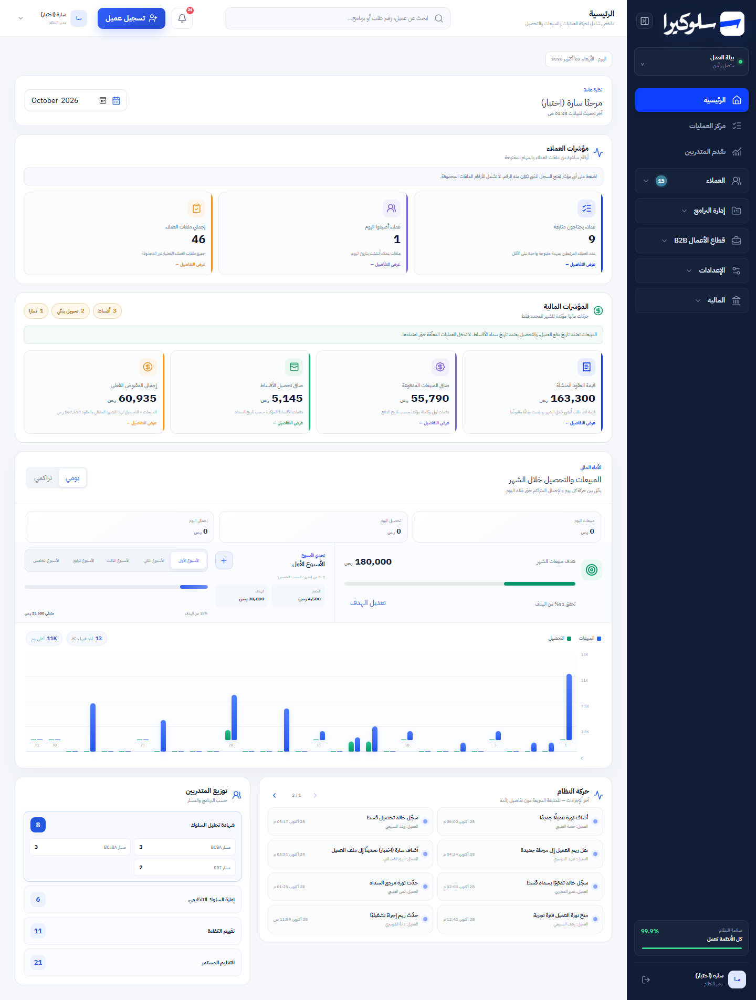
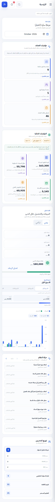

# Operations Dashboard redesign

Branch: `design/premium-operations-dashboard` · Scope: `HomeDashboard` only (the "الرئيسية" view).
The shell (sidebar, top bar) and every other module are unchanged, pending review of this direction.

## Before / after

| | Desktop 1440px | Mobile 390px |
|---|---|---|
| Before |  |  |
| After |  |  |

All screenshots use **synthetic data** (46 invented customers with `@example.test` emails, `.test` staff
accounts) in a local-only Miniflare D1 database. No production data was read or written.

## What changed and why

| Before | After | Why |
|---|---|---|
| Three stacked rows of near-identical cards (3 customer, 4 finance, 3 daily totals) | One **pulse ribbon** for customers, one **hero figure + ledger** for money, one inset stat strip tied to the chart | Each block now answers one question, and the eye lands on the one number that matters (cash actually received). |
| Open tasks returned by the API but never shown | **"الأولوية الآن" priority queue**: priority marker, department, due chip (today / tomorrow / overdue / no date) | Puts the day's priorities at the top, on mobile first of all. Uses `data.tasks`, which the API already returned. |
| Pending-review counts as small pills in a header | **"بانتظار المراجعة المالية"** panel, each type a row that opens Finance pre-filtered | The same `onOpenFinanceReview(kind)` flow, now readable and tappable. |
| Monthly target and weekly challenge squeezed into a 270px side rail | Goals row first: a **target ring** next to the weekly challenge, then the chart | Progress against the goal is the motivating headline. Shows "no target set" instead of 0%. |
| Bar chart with 7px tick labels | 220px plot with gridlines, today's column highlighted, readable ticks, legend and peak-day summary | Same data and same daily/cumulative toggle, now legible. |
| Activity as a 2-column grid of boxes | **Timeline** grouped by day, with actor initial, sentence, customer and time | Reads like what happened, in order. |
| Trainee groups as boxes with counts | Distribution list with bars relative to the largest group, still expandable by track | Shows proportion without implying percentages, since API counts can overlap. |
| 7–9px type, coloured explainer banners | 12–13px floor, methodology as a quiet footnote | Readability and calmer hierarchy. |
| Full-page "loading…" text on every month change | Skeleton on first load only. Month changes keep data visible (dimmed, `aria-busy`). Save errors show inline instead of wiping the page | Less flicker, no lost context. |

## Functional preservation

Nothing in the API, permissions, schema or business logic changed. `git diff --stat main` touches
only `app/page.tsx` (the `HomeDashboard` render block, `HomeMetric`, and one new skeleton component),
`app/globals.css`, one new test, and these docs.

The data-loading, target-saving and week-calculation code inside `HomeDashboard` is byte-for-byte
the same (Saturday–Thursday weeks, `firstSaturdayDay`, `saveTarget`, `saveWeeklyTarget`, chart
maths). The 218 removed CSS rules targeted classes used only by the old dashboard. A parser checked
that each one appears nowhere else in `page.tsx`.

Verified in the running app (local dev server, synthetic data):

| Check | Result |
|---|---|
| Daily ↔ cumulative toggle updates the stat strip and chart | ✅ |
| Week selector (5 weeks, current week marked) changes range, achieved and target | ✅ |
| Weekly target edit → save (PATCH) → value updates → restored | ✅ |
| Monthly target edit → save (PATCH) → ring 31% → 28% → restored | ✅ |
| Month picker reloads data (Sept → empty, Oct → data) | ✅ |
| Activity pager 1/2 → 2/2 | ✅ |
| Trainee group expand/collapse | ✅ |
| Pulse metrics → Operations Center / Customers | ✅ |
| Cash hero and ledger rows → Finance | ✅ |
| Review rows → Finance with review filter | ✅ |
| Priority tasks and "فتح مركز العمليات" → Operations Center | ✅ |
| **Academy role** (no finance permission): finance, performance and review panels absent; queue shows only own tasks | ✅ |
| No page-level horizontal scroll at 375, 390 and 1440px | ✅ |

Automated:

| | Before (main) | After |
|---|---|---|
| `npm test` (build + `tests/rendered-html.test.mjs`) | 79 / 79 pass | **80 / 80 pass** (1 new test for the redesign) |
| `eslint app/page.tsx` | 30 errors, 32 warnings | 30 errors, 32 warnings (all pre-existing, none in the new code) |
| `tsc --noEmit` errors in `page.tsx` | 20 | 20 (same errors, shifted lines) |

### Known limits

- "Today" in the daily totals and chart highlight still uses the existing UTC date logic. Between
  midnight and 03:00 Riyadh time it points at yesterday. That's existing behaviour, left unchanged
  on purpose. The new due-date and timeline labels use local dates.
- The native month input shows its label in the browser's language (e.g. "October 2026").
- Local preview needs workarounds: Miniflare 4.20260515 rejects compatibility date `2026-07-22`, and
  `.wrangler/deploy/config.json` redirects dev to the deploy config. Neither file was changed on this
  branch.

## Extension plan (after you approve the direction)

Each phase is its own PR. Every module keeps its API calls, permissions and test regexes. Migration
means: re-compose with the patterns in `DESIGN-SYSTEM.md`, scope CSS, delete the module's dead
legacy CSS, and add before/after screenshots and a QA checklist like the one above.

| Phase | Module(s) | Main moves |
|---|---|---|
| 0 | **Shell**: sidebar, top bar, page header | Swap the shell's hard-coded colours for `--sk-*` tokens. Real page title plus breadcrumb in the masthead pattern. Bring the 9–10px nav/meta type up to the 12px floor. Visible focus ring. |
| 1 | **Operations Center** (`LiveWork`, attention cards) | Priority queue as the main pattern. Filters become a segmented control plus chips. The customer drawer becomes a right-side sheet with a timeline. |
| 2 | **Customers** (`LiveCustomers`, customer card, notes, history) | Table with sticky header and status chips. Customer profile = masthead + journey timeline (purchase → registration → account → courses → access) + ledger of orders/payments. |
| 3 | **Academy flows** (registration, assignment, program activation, trainee progress) | Kanban columns built on the panel + queue patterns. Stage rail turns into a progress stepper. Due chips reuse the status pairs. |
| 4 | **Finance** (`LiveFinance`, installments, collections, reviews, transfers) | Hero figure + ledger at the top, review queue, installment schedule as a timeline, with the same footnote methodology. |
| 5 | **B2B workspace** | Partnership board on the queue/panel patterns. Drawer sections as ledgers. Org status signal from the status pairs. |
| 6 | **Programs, Users, Control panel, Reports** | Forms and tables on the tokens. Settings grouped in panels. Report charts reuse the dashboard chart. |
| 7 | **Clean-up** | Remove orphaned legacy CSS (e.g. `.journey-overview`, which nothing uses). Fold the old `--blue/--ink` variables into `--sk-*`. Update `MASTER.md`. |

Per-phase acceptance: tests and lint no worse than `main`, the role matrix (admin / sales / finance /
academy / b2b / viewer) clicked through, 375/768/1024/1440 screenshots, and no new dependencies.
